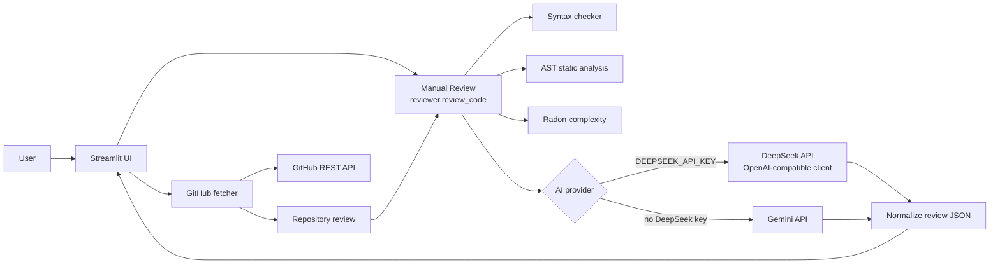

# TechSpecAnalyser (CodeLens AI)

TechSpecAnalyser is a Streamlit application for inspecting source code and public GitHub repositories. It combines deterministic syntax, AST, and Radon analysis with optional AI-generated observations from Google Gemini or DeepSeek.

## Problem Statement

Code reviews and documentation are time-consuming, and useful feedback is difficult to obtain consistently. TechSpecAnalyser provides a central interface for static-analysis findings and AI-assisted review observations while keeping the two analysis types distinct.

## Objectives

- Run deterministic analysis locally without an AI API.
- Detect syntax errors and selected AST issues in Python source.
- Measure Python cyclomatic complexity and maintainability.
- Produce optional AI summaries, bug observations, improvement suggestions, and improved code.
- Review supported source files from public GitHub repositories.
- Keep provider credentials out of source code and presentation output.

## Implemented Features

- Manual source-code review through Streamlit.
- Python syntax validation.
- Python AST-based function argument validation.
- Radon cyclomatic complexity and maintainability index analysis for Python.
- Optional Gemini review.
- Optional DeepSeek review through an OpenAI-compatible API client.
- Existing JSON review schema for both AI providers.
- Repository URL validation and recursive repository file discovery.
- Default-branch detection and branch-name handling with slashes.
- Supported-extension filtering and repository/file limits.
- Per-file repository failure isolation.
- Repository review counters for completed, failed, and AI-unavailable files.
- Streamlit session-state storage for manual and repository results.

## System Architecture



Provider selection is automatic: DeepSeek is selected when `DEEPSEEK_API_KEY` is present or `AI_PROVIDER=deepseek` is configured; Gemini is selected otherwise, unless `AI_PROVIDER=gemini` is set. Gemini can still use Streamlit secrets; DeepSeek is read from `DEEPSEEK_API_KEY` only.

## Technology Stack

- Python
- Streamlit
- Google `google-genai`
- OpenAI Python client for DeepSeek
- Python `ast` module
- Radon
- GitHub REST API
- pytest

## Methodology

1. The user enters source code or selects a public GitHub repository.
2. Empty input and Python syntax errors are identified locally.
3. Python static analysis checks AST call arguments and reports deterministic findings.
4. Radon calculates Python complexity details and maintainability metrics when supported.
5. The selected AI provider receives the source and a structured JSON-only prompt.
6. Provider responses are parsed and normalized to the application's review schema.
7. Static findings, AI findings, and provider status are displayed separately.
8. Repository reviews process files individually so one file failure does not invalidate the whole repository review.

Static and AI output are independent: a provider failure does not remove successful syntax, AST, Radon, or repository-fetch results.

## Static Analysis and AST Implementation

- `syntax_checker.py` uses `ast.parse()` and returns syntax findings.
- `static_analysis.py` visits AST nodes to detect positional argument mismatches based on Python callable signatures, when that information can be resolved.
- `complexity.py` uses Radon to report cyclomatic complexity and maintainability index where applicable.
- Local static analysis currently targets Python. Other editor languages are sent through the AI-provider path and do not receive Radon or Python AST analysis.

## AI Provider Integration

The AI response must preserve this schema:

```json
{
  "summary": "",
  "bugs": [],
  "improvements": [],
  "complexity_notes": "",
  "improved_code": "",
  "overall_score": 8
}
```

### Gemini

Gemini uses the Google Gen AI client, `gemini-2.5-flash`, `GEMINI_API_KEY`, and optionally Streamlit secrets.

### DeepSeek

DeepSeek uses the official OpenAI-compatible client with:

- Base URL: `https://api.deepseek.com`
- Model: `deepseek-chat`
- Environment variable: `DEEPSEEK_API_KEY`
- JSON-object response mode

No provider key is read from application source, logs, or returned UI messages.

## GitHub Repository Integration

`github_fetcher.py` validates public repository URLs and fetches repository contents through the GitHub REST API. The implementation:

- Resolves repository branches and handles branch names containing `/`.
- Filters by supported source-file extensions.
- Applies repository and per-file limits.
- Isolates individual download failures.
- Returns counts for eligible, reviewed, skipped, and failed files.

Repository limits and supported extensions are defined in [github_fetcher.py](github_fetcher.py) and should be treated as the source of truth.

## Project Structure

```text
app.py                 Streamlit entry point and result views
reviewer.py            Provider orchestration and review aggregation
github_fetcher.py      GitHub repository discovery and content fetching
syntax_checker.py      Python syntax validation
static_analysis.py     Python AST checks
complexity.py          Radon complexity and maintainability analysis
utils.py               JSON normalization and presentation helpers
requirements.txt       Runtime and test dependencies
test_reviewer.py       Review and provider tests
test_api_key.py        Gemini and DeepSeek credential tests
test_github_fetcher.py Repository-fetch tests
```

## Installation

Requirements:

- Python 3.10 or newer
- Git
- A virtual environment is recommended

```bash
git clone https://github.com/Srish-pathak/Code-Visualiser-Python.git
cd Code-Visualiser-Python
python -m venv .venv
source .venv/bin/activate
python -m pip install -r requirements.txt
```

On Windows:

```powershell
python -m venv .venv
.venv\Scripts\Activate.ps1
python -m pip install -r requirements.txt
```

## Environment Variables and Secrets

Configure one provider for AI-assisted analysis:

```bash
export DEEPSEEK_API_KEY="your-key"
# Optional explicit provider selection:
export AI_PROVIDER="deepseek"
```

Or configure Gemini:

```bash
export GEMINI_API_KEY="your-key"
# Optional explicit provider selection:
export AI_PROVIDER="gemini"
```

DeepSeek credentials are read from the environment only. Gemini can also be configured in Streamlit secrets as:

```toml
GEMINI_API_KEY = "your-key"
```

Do not commit real keys, `.env` files, or Streamlit secrets.

## Running the Application

```bash
streamlit run app.py
```

The default local address is usually `http://localhost:8501`.

## Testing

Run the complete suite:

```bash
pytest -q
```

Compile Python files:

```bash
python -m compileall -q .
```

Provider tests use mocked clients and must not consume paid API quota or credits.

## Actual Test Results

Verified on 5 November 2026:

- Total: 29 tests
- Passed: 29
- Failed: 0

The suite includes syntax, static complexity, GitHub fetch, Gemini credential/provider, DeepSeek credential/provider, and repository aggregation tests. Provider tests use mocked clients and responses.

## Application Screenshots

> Placeholder: add the manual code-review dashboard screenshot here.

> Placeholder: add the static-analysis findings screenshot here.

> Placeholder: add the repository review summary screenshot here.

> Placeholder: add the before/after improved-code screenshot here.

## Security Considerations

- API keys are read only from environment variables or supported Gemini Streamlit configuration.
- Provider credentials are not printed in user-facing error text.
- Error handling contains provider status and generic guidance rather than raw credential data.
- Secret-like files should remain excluded through `.gitignore`.
- Repository content is supplied to the selected AI provider only through the review prompt.

## Limitations

- AI review quality depends on the selected provider and can produce incomplete or incorrect observations.
- Static analysis is strongest for Python syntax and the implemented AST/Radon checks.
- Some non-Python languages receive AI analysis but not local Radon or Python AST analysis.
- A provider rate limit, permission failure, timeout, or malformed response disables only AI output.
- Repository review depends on GitHub availability and public repository access.
- Fetch and file limits are intentionally bounded; files outside them are skipped.
- AI findings do not have a formally verified correctness percentage.

## Future Enhancements

- Add more language-specific deterministic analyzers.
- Add explicit provider status and manual provider selection in the UI.
- Add response-schema validation with provider-independent tests.
- Add repository review history persistence.
- Add configurable repository limits through validated configuration.
- Expand AST checks and add focused false-positive tests.

## Academic Project Information

- Project: Engineering Project-I
- Project name: TechSpecAnalyser (CodeLens AI)
- Repository: https://github.com/Srish-pathak/Code-Visualiser-Python
- Theme: Static-analysis-grounded automated code review and documentation support
