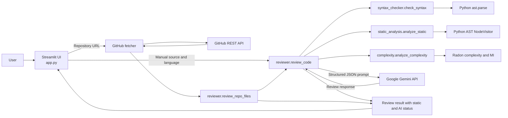

# TechSpecAnalyser (CodeLens AI)

TechSpecAnalyser is a Python and Streamlit application developed for Engineering Project-I. It provides static-analysis-grounded code review for source pasted into the browser and for supported source files fetched from public GitHub repositories. Google Gemini is used as an optional AI-assisted review layer; deterministic syntax, AST, and complexity analysis can run independently of Gemini.

## Table of Contents

- [Project Overview](#project-overview)
- [Problem Statement](#problem-statement)
- [Objectives](#objectives)
- [Implementation Status](#implementation-status)
- [Key Features](#key-features)
- [System Architecture](#system-architecture)
- [Technology Stack](#technology-stack)
- [Working Methodology](#working-methodology)
- [Static Analysis Implementation](#static-analysis-implementation)
- [Gemini API Integration](#gemini-api-integration)
- [GitHub Repository Integration](#github-repository-integration)
- [User Interface](#user-interface)
- [Project Folder Structure](#project-folder-structure)
- [Installation and Setup](#installation-and-setup)
- [Configuration](#configuration)
- [Running the Application](#running-the-application)
- [Testing](#testing)
- [Security Considerations](#security-considerations)
- [Limitations](#limitations)
- [Future Enhancements](#future-enhancements)
- [Academic Project Information](#academic-project-information)

## Project Overview

Developers need feedback on source code before code reaches review or testing stages. TechSpecAnalyser combines:

1. Python syntax parsing and AST traversal.
2. Radon cyclomatic-complexity and maintainability-index calculation.
3. Optional structured review generated through Google Gemini.
4. Public GitHub repository file retrieval and aggregation.

The application presents manual review results and repository-wide results in a Streamlit dashboard. Gemini availability does not determine whether deterministic analysis runs.

## Problem Statement

Manual review of source code is time-consuming, and AI-only reviews may not be reproducible or available when an external API is unavailable. The project therefore provides a system in which syntax, static checks, and complexity metrics are calculated locally, while Gemini adds optional explanatory and improvement-oriented observations.

This is not a claim that Gemini output is mathematically verified. AI findings are displayed as review suggestions and are combined with locally calculated findings.

## Objectives

- Detect Python syntax errors using `ast.parse()`.
- Traverse the Python AST for a focused function-call argument check.
- Calculate Radon cyclomatic complexity and maintainability index for Python.
- Request structured Gemini feedback for supported source languages.
- Support analysis of public GitHub repositories within defined file and size limits.
- Preserve useful results when Gemini is unavailable.
- Present file-wise repository review results.
- Provide automated tests for URL handling, repository fetching, Gemini responses, syntax, complexity, and partial repository review.

## Implementation Status

| Area | Status | Actual implementation |
|---|---|---|
| Manual source review | Implemented | Streamlit editor, syntax/static review, optional Gemini review, score, and improved-code display |
| Python syntax analysis | Implemented | `ast.parse()` in `syntax_checker.py` |
| Python AST checks | Implemented | Function-call argument-count mismatch check in `static_analysis.py` |
| Radon metrics | Implemented for Python | Cyclomatic complexity, complexity ranks, and maintainability index |
| Gemini integration | Implemented | Structured JSON request using `google-genai` and separate AI status handling |
| GitHub URL and repository analysis | Implemented | GitHub REST metadata and recursive tree fetching |
| File-wise repository dashboard | Implemented | Per-file source, findings, improvements, and complexity |
| Static/AI result separation | Implemented | `analysis_status` separates static and Gemini outcomes |
| Repository partial failure handling | Implemented | Individual download and review failures are counted where possible |
| Automated tests | Implemented | pytest and unittest-style tests run in the repository |
| Deployment configuration | Partially implemented | Streamlit configuration and Codespaces setup exist; no deployed URL is verified from this repository |
| Persistent review history | Not implemented | No database or history persistence module exists |
| Full multi-language static analyzers | Partially implemented | Non-Python languages receive Gemini review, but Radon/static AST metrics are Python-only |

## Key Features

### Manual Code Review

- Language selection for Python, C++, Java, JavaScript, JSX, TypeScript, TSX, HTML, CSS, and SCSS.
- Optional Ace editor integration with a standard Streamlit text area fallback.
- Python syntax validation before Gemini review.
- Python AST call-signature mismatch findings.
- Radon complexity metrics for Python.
- Gemini summary, bug observations, improvements, complexity notes, score, and improved-code output.
- Clear unavailable-AI and unavailable-score states.

### Repository Review

- Public GitHub repository URL validation.
- Repository metadata retrieval.
- Optional branch URLs.
- Resolution of branch names containing `/`.
- Recursive GitHub tree retrieval.
- Extension filtering and excluded-directory filtering.
- 30-file fetch limit.
- 200 KiB limit per source file.
- Individual download-error reporting.
- Repository-level and file-level review presentation.

### Dashboard

The dashboard includes tabs for bugs, improvements, complexity, score, and before/after code. Repository review includes repository counts, file-review counts, critical and warning counts, repository quality, download failures, findings, improvements, and per-file details.

## System Architecture



### Main Code Path

`app.py` is the Streamlit entry point. Manual reviews call `review_code()`. Repository reviews call `fetch_public_repository()`, then pass fetched files to `review_repo_files()`.

`reviewer.py` coordinates syntax checks, AST/static checks, complexity calculation, Gemini credential lookup, API invocation, response parsing, and repository result aggregation.

`github_fetcher.py` handles GitHub URL parsing, branch resolution, API requests, supported extension filtering, repository limits, UTF-8 decoding, and file-download errors.

## Technology Stack

| Technology | Actual use |
|---|---|
| Python | Application implementation and analysis logic |
| Streamlit | Web interface, session state, tabs, metrics, and controls |
| Google Gemini API through `google-genai` | Optional AI-assisted structured review |
| Python AST | Syntax validation and deterministic call-signature traversal |
| Radon | Cyclomatic complexity and maintainability index |
| GitHub REST API | Repository metadata, branches, recursive trees, and file contents |
| pytest / unittest | Automated testing |

The direct dependencies declared in `requirements.txt` are:

- `streamlit>=1.38`
- `google-genai>=1.0`
- `radon>=6.0`
- `pytest>=8.0`

`streamlit-ace` is attempted optionally in `app.py`. The application falls back to `st.text_area` if that package is not installed. It is not currently declared in `requirements.txt`.

## Working Methodology

### Manual Review Workflow

1. The user selects a language and enters source code.
2. The application rejects an empty source input.
3. For Python, `check_syntax()` calls `ast.parse()`.
4. For valid Python, AST-based static checks run.
5. Python complexity analysis runs through Radon.
6. Gemini credentials are checked.
7. Gemini receives a structured JSON prompt and review schema.
8. The response is parsed and normalized.
9. Static and AI findings are combined in the returned result.
10. Streamlit displays component status and the available review sections.

### Repository Review Workflow

1. The user enters a GitHub repository or branch URL.
2. The URL parser validates the GitHub host and extracts owner and repository.
3. The repository metadata endpoint is queried to obtain the default branch.
4. A recursive repository tree is requested.
5. Blob entries are filtered by extensions and excluded directories.
6. Supported files larger than 200 KiB and files beyond the first 30 eligible files are skipped.
7. Each eligible file is downloaded independently through the contents API.
8. Each successfully fetched file is passed to the review pipeline.
9. Static/AI counts and repository averages are calculated.
10. The dashboard displays repository and file-level outcomes.

## Static Analysis Implementation

### Python Syntax Validation

`syntax_checker.py` uses Python's built-in AST parser:

```python
ast.parse(code)
```

For a `SyntaxError`, the module returns a critical finding containing the line number and parser message. Invalid Python is not sent to Gemini.

### Python AST Static Check

`static_analysis.py` defines an AST `NodeVisitor`. It records positional argument counts for Python `FunctionDef` nodes and examines calls whose callee is a matching `ast.Name`.

When the call supplies a different number of positional arguments than the locally discovered function definition, it creates a critical finding containing:

- Source line
- Function name
- Expected positional argument count
- Received positional argument count

The check is local and intentionally limited. It does not perform complete type, symbol, or signature resolution.

### Radon Complexity

`complexity.py` calls Radon for Python-only complexity:

- `radon.complexity.cc_visit(code)` calculates cyclomatic complexity blocks.
- `radon.metrics.mi_visit(code, multi=True)` calculates maintainability index.
- Average complexity is calculated across returned blocks.
- Complexity is ranked with the project-defined thresholds: A through F.

When no Radon complexity blocks are found, the module returns a baseline complexity of `1` and Radon rating `A` for the no-block case. Syntax errors and maintainability failures are represented separately.

## Gemini API Integration

`reviewer.py` uses `google.genai.Client` and requests a JSON review from `gemini-2.5-flash`.

The prompt requests:

- Summary
- Bug observations
- Improvement suggestions
- Complexity notes
- Improved code
- Overall score from 1 to 10

Responses are normalized through `safe_json_parse()` in `utils.py`. The JSON parser:

- Handles an empty response as a failure.
- Removes common Markdown JSON fences.
- Attempts to isolate the outer JSON object.
- Supplies missing expected fields.
- Clamps numeric scores to the 1-to-10 range.

The application handles message classification for Gemini quota, permission, credential, timeout, network, and invalid-response failures. Gemini failure does not stop static analysis or complexity analysis.

The model's findings should be treated as AI observations rather than proven defects.

## GitHub Repository Integration

`github_fetcher.py` uses Python standard-library HTTP requests rather than a separate GitHub package.

Supported extensions are:

`.py`, `.java`, `.cpp`, `.cc`, `.cxx`, `.hpp`, `.h`, `.js`, `.jsx`, `.ts`, `.tsx`, `.html`, `.css`, and `.scss`.

The fetcher excludes generated or dependency directories such as `.git`, virtual environments, `node_modules`, vendor/build directories, coverage output, `.next`, and IDE directories.

### Repository Limits

- Maximum eligible files submitted for review: 30.
- Maximum tree-reported file size: 200 KiB.
- GitHub API timeout: 15 seconds.
- Downloaded UTF-8 text is also checked against 200 KiB after decoding.

Repository results record detected eligible files, unsupported and oversized skips, file-limit skips, successful downloads, download failures, and truncated GitHub trees.

## User Interface

Application screenshots are intentionally represented by placeholders until genuine screenshots are captured.

### Main Dashboard

```text
[Application screenshot placeholder: main dashboard and code editor]
```

### Static and AI Review Tabs

```text
[Application screenshot placeholder: bugs, improvements, complexity, score, and before/after tabs]
```

### Repository Review Dashboard

```text
[Application screenshot placeholder: repository metrics and file-wise findings]
```

### Deployed Application

No deployed application URL could be verified from the repository files or Git configuration. Add the verified URL here only after deployment ownership and availability are confirmed.

## Project Folder Structure

```text
Code-Visualiser-Python/
├── app.py                  # Streamlit application and dashboard
├── reviewer.py             # Gemini and review pipeline orchestration
├── github_fetcher.py       # GitHub URL, tree, and file retrieval
├── static_analysis.py      # Python AST NodeVisitor check
├── syntax_checker.py       # Python syntax validation
├── complexity.py           # Radon complexity and maintainability metrics
├── utils.py                # Language configuration, JSON parsing, display helpers
├── test_github_fetcher.py  # URL and repository-fetch tests
├── test_api_key.py         # Gemini credential tests
├── test_reviewer.py        # Static, Gemini, and repository-review tests
├── test.py                 # Gemini model-list utility
├── requirements.txt        # Python dependencies
├── README.md
├── .gitignore
├── .streamlit/
│   └── config.toml         # Streamlit toolbar configuration
└── .devcontainer/
    └── devcontainer.json   # Codespaces/dev container setup
```

## Installation and Setup

Use Python 3.10 or newer. The included development container uses Python 3.11.

### Local Environment

```bash
git clone https://github.com/Srish-pathak/Code-Visualiser-Python.git
cd Code-Visualiser-Python
python -m venv .venv
```

Activate on Linux or macOS:

```bash
source .venv/bin/activate
```

Activate on Windows:

```powershell
.venv\Scripts\Activate.ps1
```

Install dependencies:

```bash
python -m pip install -r requirements.txt
```

## Configuration

### Gemini API Key

Gemini credentials are read from:

1. The `GEMINI_API_KEY` environment variable.
2. Streamlit secrets under `GEMINI_API_KEY`.

Environment variable on Linux/macOS:

```bash
export GEMINI_API_KEY="your-api-key"
```

Environment variable on Windows PowerShell:

```powershell
$env:GEMINI_API_KEY="your-api-key"
```

Streamlit secrets:

```toml
GEMINI_API_KEY = "your-api-key"
```

Place Streamlit secrets in `.streamlit/secrets.toml` for local development. The repository's `.gitignore` excludes `.streamlit/secrets.toml`.

Static and Radon analysis can run without Gemini. Gemini-assisted review and AI scores require a valid key, service access, and quota.

### Optional Ace Editor

If `streamlit-ace` is installed, the application attempts to use it as the source editor. If it is unavailable, the application automatically uses `st.text_area`.

## Running the Application

From the repository root:

```bash
streamlit run app.py
```

The development container is configured to start Streamlit on port `8501`.

## Testing

Run the suite from the repository root:

```bash
pytest -q
```

Compile the Python sources:

```bash
python -m compileall -q .
```

### Current Verified Results

At the time of documentation verification:

- **21 tests passed**
- **0 tests failed**

The suite includes mocked Gemini credential, response, quota, and permission tests; Python syntax and complexity checks; repository URL and extension tests; repository limits and partial download tests; and successful and partial repository review tests.

Some requested defensive scenarios are not independently covered by dedicated tests:

- Timeout-specific Gemini exceptions.
- Invalid-key-specific Gemini exceptions.
- Network exceptions may be covered by general exception handling but have no dedicated named test.

## Security Considerations

- No API key should be committed to source control.
- `.streamlit/secrets.toml` is excluded by `.gitignore`.
- Environment-file patterns are excluded by `.gitignore`.
- Public repository URLs must use `github.com`; credentials in repository URLs are rejected.
- Private repository metadata is rejected when the GitHub API identifies it as private.
- Repository reviews send fetched source code to Gemini if AI review is enabled.
- Users should submit only repositories and source code they are authorized to share.
- Gemini API failures are converted into user-facing status messages rather than exposing raw exception details in the interface.

## Limitations

- Gemini output is external and may fail due to missing credentials, quota, permissions, timeout, network, or malformed response.
- Repository review is limited to 30 supported files and 200 KiB per file.
- AST/static checks are Python-specific and limited to locally discovered function definitions and positional argument counts.
- Radon metrics are used only for Python.
- Non-Python languages do not have deterministic syntax or complexity modules in this implementation.
- The repository overview score depends on AI scores returned by Gemini.
- The repository dashboard does not implement persistent history.
- Branch-resolution behavior depends on GitHub API responses.
- No security scanner, secrets scanner, type checker, or complete linter is implemented.
- Results are not certified as bug-free or suitable for production release decisions.

## Future Enhancements

- Persistent history and comparison between review runs.
- More comprehensive Python AST checks.
- Dedicated static analyzers for additional supported languages.
- Optional AST or complexity fallback metrics for repository files.
- Explicit richer repository coverage and skip metrics.
- Dedicated timeout, invalid-key, and network-failure tests.
- Optional CI workflow for automated pytest and compilation checks.
- Configurable repository file and byte limits.
- User-controlled AI-provider settings.
- Visual regression screenshots and downloadable reports.

## Academic Project Information

**Project title:** TechSpecAnalyser (CodeLens AI)

**Project type:** Individual Engineering Project-I

**Primary domain:** Software engineering, static source analysis, and AI-assisted code review

This README describes implementation present in the repository at the time of documentation verification. It does not claim capabilities absent from the code, measured accuracy, multi-agent orchestration, or complete security analysis.
