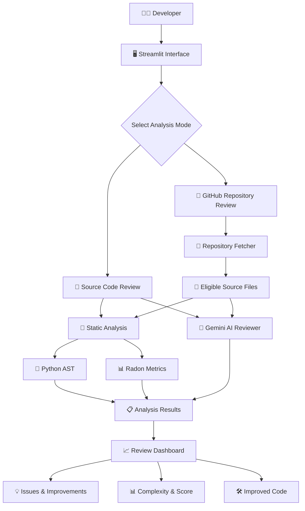

# TechSpecAnalyser (CodeLens AI)

### AI-Assisted Code Review & Static Analysis Platform

**Analyze. Understand. Improve.**

TechSpecAnalyser, also known as **CodeLens AI**, is an AI-assisted code review platform that combines traditional static analysis techniques with Generative AI to help developers identify potential code issues, understand complexity, and improve code quality.

The platform supports individual source-code analysis as well as public GitHub repository analysis. It combines deterministic analysis with AI-generated suggestions to provide a more informative code-review experience.

---

## ✨ Key Features

### 🔍 1. AI-Powered Code Review
- Reviews submitted source code using the Gemini API.
- Identifies potential bugs and code-quality concerns.
- Generates improvement suggestions.
- Provides explanations to help developers understand their code.

### 🧠 2. Static Code Analysis
- Uses Python AST to inspect Python source code.
- Performs syntax validation.
- Checks selected structural code patterns.
- Provides deterministic analysis independent of the AI service.

### 📊 3. Code Complexity Analysis
- Integrates Radon for Python code metrics.
- Calculates cyclomatic complexity.
- Evaluates maintainability using the Maintainability Index.
- Helps developers identify code that may need simplification.

### 🐙 4. GitHub Repository Analysis
- Accepts public GitHub repository URLs.
- Fetches eligible source files from repositories.
- Performs file-wise code analysis.
- Displays review results for supported file types.
- Applies file-count and file-size limits to keep analysis manageable.

### 💡 5. Code Improvement Suggestions
- Highlights potential issues.
- Suggests cleaner coding approaches.
- Provides AI-generated improved code where available.
- Helps developers understand possible improvements.

### 📈 6. Code Quality Score
- Presents an overall AI-generated code-review score.
- Combines review insights into an understandable summary.
- Helps developers identify areas for further improvement.

---

## 🏗️ System Architecture



---

## 🔄 How It Works

1. **Input:** The developer submits source code or a public GitHub repository URL.
2. **Repository Processing:** The repository fetcher identifies eligible source files.
3. **Static Analysis:** Python AST checks syntax and selected code structures.
4. **Complexity Analysis:** Radon calculates Python code complexity metrics.
5. **AI Review:** Gemini analyzes the submitted code and generates structured review insights.
6. **Result Generation:** The platform organizes available results into a review dashboard.
7. **Improvement:** Developers use the findings and suggestions to improve their code.

> **Note:** Static analysis and AI review are separate components. Static analysis can provide results even when the AI API is unavailable.

---

## 🛠️ Technology Stack

| Category | Technologies |
|---|---|
| Programming Language | Python |
| Frontend / Interface | Streamlit |
| AI Integration | Google Gemini API |
| Static Analysis | Python AST |
| Complexity Analysis | Radon |
| Repository Integration | GitHub API |
| Testing | Pytest |
| Version Control | Git & GitHub |

---

## 📁 Project Structure

```text
TechSpecAnalyser/
│
├── app.py                  # Streamlit application
├── reviewer.py             # Gemini-based AI code reviewer
├── github_fetcher.py       # GitHub repository fetching
├── static_analysis.py     # Static analysis utilities
├── syntax_checker.py      # Python syntax checking
├── complexity.py          # Radon complexity metrics
├── utils.py                # Helper functions
│
├── test.py                 # Tests
├── test_reviewer.py        # AI reviewer tests
├── test_github_fetcher.py  # Repository fetcher tests
├── test_api_key.py         # API key-related checks
│
├── requirements.txt        # Project dependencies
├── .gitignore
└── README.md
```

---

## ⚙️ Installation & Setup

### Prerequisites

- Python 3.10 or later (use a compatible version for the installed dependencies).
- Git.
- A Google Gemini API key for AI-powered review.

### 1. Clone the Repository

```bash
git clone https://github.com/Srish-pathak/Code-Visualiser-Python.git
```

### 2. Navigate to the Project Directory

```bash
cd Code-Visualiser-Python
```

### 3. Create a Virtual Environment

```bash
python -m venv venv
```

Activate it:

**Windows**
```bash
venv\Scripts\activate
```

**Linux / macOS**
```bash
source venv/bin/activate
```

### 4. Install Dependencies

```bash
pip install -r requirements.txt
```

### 5. Configure the Gemini API Key

Set your API key as an environment variable.

**Windows PowerShell**
```powershell
$env:GEMINI_API_KEY="your_api_key_here"
```

**Linux / macOS**
```bash
export GEMINI_API_KEY="your_api_key_here"
```

Never commit API keys or other credentials to GitHub.

### 6. Run the Application

```bash
streamlit run app.py
```

The application will open in your browser, generally at:

```text
http://localhost:8501
```

---

## 🧪 Testing

Run the test suite using:

```bash
pytest -v
```

Run Python compilation checks:

```bash
python -m compileall .
```

Testing helps verify repository fetching, reviewer functionality, and other project components.

**Important:** Report the actual test results from your latest run rather than assuming all tests pass.

---

## 🔐 Security & Reliability

- API credentials are read through environment variables.
- Public repository fetching is subject to configured file-count and file-size limits.
- Generated and dependency directories are excluded from repository scanning.
- Static analysis does not depend on Gemini availability.
- API errors and invalid AI responses should be handled gracefully.

---

## ⚠️ Current Limitations

- AI-powered review requires a valid and available Gemini API quota.
- Static AST and Radon analysis is currently Python-specific.
- Other supported source-file types do not receive the same Python AST and Radon metrics.
- Repository analysis is restricted by configured file-count and file-size limits.
- AI-generated suggestions should be reviewed by developers before being applied.
- The tool does not replace human code review, execution-based testing, or security auditing.

---

## 🔮 Future Enhancements

- 🔁 Multi-provider AI support (Gemini, Claude, and DeepSeek).
- 🌐 Expanded language-specific static analysis.
- 📚 Automated technical documentation generation.
- 🛡️ Advanced security vulnerability detection.
- 📜 Persistent review history.
- 👥 Collaborative code review.
- 🔄 GitHub pull-request integration.
- 📊 More detailed code-quality analytics.

*These are planned enhancements, not claims about currently implemented functionality.*

---

## 🎯 Project Objective

The primary objective of TechSpecAnalyser is to make code review more accessible, understandable, and efficient by combining traditional static analysis with AI-assisted feedback.

It aims to help developers identify potential issues, understand code complexity, and improve software quality through structured analysis and actionable suggestions.

---

## 👩‍💻 Developer

**Srishti Pathak**  
Integrated B.Tech & M.Tech – Computer Science and Engineering  
Specialization: Artificial Intelligence and Data Science  
Central University of Jharkhand

🔗 **GitHub:** https://github.com/Srish-pathak

---

## ⭐ Support

If you find this project interesting, consider giving the repository a ⭐ on GitHub!

**TechSpecAnalyser (CodeLens AI) — Making Code Review Smarter, One Analysis at a Time.**
